# Индивидуальная работа по PHP: «Книжная полка»

**Студент:** Ganja Andrei  
**Группа:** _номер группы_  
**Преподаватель:** Boris Vișnevschi  
**Дата:** 23.11.2026

Веб-приложение «Книжная полка» — каталог книг, которые советуют читатели. Гости
просматривают и ищут книги, зарегистрированные пользователи добавляют свои,
а администратор управляет всеми данными.

**Технологии:** PHP 8, MySQL, PDO, HTML5, Bootstrap 5, JavaScript. Фреймворки не используются,
архитектура MVC написана самостоятельно.

---

## Содержание

1. [Описание работы](#1-описание-работы)
2. [Инструкция по запуску](#2-инструкция-по-запуску)
3. [Документация проекта](#3-документация-проекта)
   - [3.1. Функциональные возможности](#31-функциональные-возможности)
   - [3.2. Роли пользователей](#32-роли-пользователей)
   - [3.3. Сценарии взаимодействия пользователей с приложением](#33-сценарии-взаимодействия-пользователей-с-приложением)
   - [3.4. Структура базы данных](#34-структура-базы-данных)
   - [3.5. Архитектура приложения](#35-архитектура-приложения)
   - [3.6. Безопасность](#36-безопасность)
4. [Примеры использования](#4-примеры-использования)
   - [4.1. Скриншоты](#41-скриншоты)
   - [4.2. Фрагменты кода](#42-фрагменты-кода)
5. [Ответы на контрольные вопросы](#5-ответы-на-контрольные-вопросы)
6. [Список использованных источников](#6-список-использованных-источников)
7. [Выводы](#7-выводы)

---

## 1. Описание работы

**Цель работы:** разработать веб-приложение средней сложности, функционал которого
реализован на стороне сервера, с аутентификацией пользователей, общедоступным
и защищённым разделами, формами с проверкой данных и ролью администратора.

**Предметная область.** Приложение хранит каталог книг. У каждой книги есть название,
автор, жанр, год издания, язык, отметка «рекомендую» и описание. Книги можно искать
по нескольким критериям.

**Соответствие требованиям задания:**

| Требование | Как выполнено |
|---|---|
| Регистрация и вход | Страницы «Регистрация» и «Вход» |
| Доступ к защищённым разделам после входа | «Добавить книгу» — для авторизованных, «Админ-панель» — только для администратора |
| Безопасное хранение паролей (хэширование) | `password_hash()` / `password_verify()`, в БД хранится только хэш |
| Доп. задание: восстановление пароля | Ссылка с одноразовым токеном на 1 час, отправляется «письмом» |
| Общедоступный компонент, 2–3 динамических блока из БД | Главная: «Новые поступления», «Читатели рекомендуют», «Жанры» |
| Форма создания ресурса, не менее 5 полей разных типов | Форма «Добавление книги»: 7 полей (text, select, number, radio, checkbox, textarea) |
| Проверка на клиенте и на сервере, понятные ошибки | HTML5 + JavaScript на клиенте, класс `Validator` на сервере, ошибки под каждым полем |
| Форма поиска | Поиск по названию или автору, жанру, языку и диапазону годов |
| Роль «администратор», 3–7 функций | 4 функции: книги (CRUD), пользователи, создание администраторов, жанры |
| Создание учётных записей администратора | Раздел «Новый админ» в админ-панели |
| Управление данными в БД (просмотр, добавление, редактирование, удаление) | Раздел «Книги» и раздел «Жанры» |
| Защита от вредоносного кода | Подготовленные запросы PDO, `htmlspecialchars`, CSRF-токены |
| Сессии для управления доступом | `$_SESSION`, `session_regenerate_id()`, проверка прав на сервере |
| Модульная архитектура / MVC | Разделение на `core`, `models`, `controllers`, `views` |
| PHPDoc | У каждого класса, метода и функции описаны параметры, результат и назначение |

---

## 2. Инструкция по запуску

**Что нужно:** [XAMPP](https://www.apachefriends.org/) (PHP 8 и MySQL), браузер.

1. Скачайте проект:
   ```
   git clone <ссылка на этот репозиторий>
   ```
2. Запустите **MySQL** в XAMPP Control Panel.
3. Создайте базу данных одним из способов:
   - phpMyAdmin → вкладка «Импорт» → файл `database/schema.sql`;
   - или в консоли из папки проекта:
     ```
     C:\xampp\mysql\bin\mysql.exe -u root < database\schema.sql
     ```
4. Если у MySQL другой пользователь или пароль, поменяйте их в `config/config.php`.
5. Запустите встроенный веб-сервер PHP из папки проекта:
   ```
   C:\xampp\php\php.exe -S localhost:8080 -t public
   ```
6. Откройте в браузере http://localhost:8080

**Тестовые учётные записи** (создаются скриптом `schema.sql`):

| Роль | Email | Пароль |
|---|---|---|
| Администратор | admin@bookshelf.local | admin123 |
| Пользователь | reader@bookshelf.local | user123 |

> Письма для восстановления пароля не отправляются на настоящую почту, а записываются
> в файл `storage/mail.log`. Ссылку для сброса пароля нужно скопировать оттуда.

---

## 3. Документация проекта

### 3.1. Функциональные возможности

**Общедоступная часть (без входа):**
- главная страница с тремя динамическими блоками: новые книги, рекомендуемые книги, жанры с количеством книг;
- поиск книг по названию или автору, жанру, языку и диапазону лет издания;
- страница книги с подробной информацией;
- регистрация, вход, восстановление пароля.

**Для авторизованного пользователя:**
- добавление книги через форму с проверкой данных;
- выход из системы.

**Для администратора (админ-панель):**
1. **Управление книгами** — просмотр всех книг, добавление, редактирование и удаление.
2. **Управление пользователями** — просмотр списка (роль, количество книг, дата регистрации) и удаление.
   Удалить свою учётную запись нельзя.
3. **Создание администраторов** — регистрация новой учётной записи сразу с ролью `admin`.
4. **Управление жанрами** — добавление, переименование и удаление. Жанр, в котором есть книги, удалить нельзя.

На главной странице админ-панели выводится статистика: количество книг, пользователей и жанров.

### 3.2. Роли пользователей

| Возможность | Гость | Пользователь | Администратор |
|---|:---:|:---:|:---:|
| Главная, поиск, просмотр книги | ✅ | ✅ | ✅ |
| Регистрация, вход, восстановление пароля | ✅ | — | — |
| Добавление книги | ❌ | ✅ | ✅ |
| Админ-панель | ❌ | ❌ | ✅ |

Если гость откроет защищённую страницу, его перенаправит на страницу входа.
Если обычный пользователь откроет админ-панель, он получит ошибку **403 «Доступ запрещён»**.

### 3.3. Сценарии взаимодействия пользователей с приложением

**Сценарий 1. Гость ищет книгу**
1. Гость открывает главную страницу и видит новые книги, рекомендации и список жанров.
2. Нажимает на жанр «Фантастика» и попадает на страницу поиска, где фильтр по жанру уже выбран.
3. Дополнительно выбирает язык «Английский» и нажимает «Найти».
4. Открывает найденную книгу и читает описание.

**Сценарий 2. Регистрация и добавление книги**
1. Пользователь нажимает «Регистрация» и вводит логин, email, пароль и подтверждение пароля.
2. Если пароли не совпадают или логин занят, под полем появляется сообщение об ошибке.
3. После успешной регистрации пользователь сразу оказывается в системе, и в меню появляется пункт «Добавить книгу».
4. Пользователь заполняет форму. Если, например, год указан больше текущего, форма не отправляется и поле подсвечивается красным.
5. После исправления ошибок книга сохраняется, и открывается её страница с сообщением «Книга успешно добавлена!».

**Сценарий 3. Восстановление пароля**
1. На странице входа пользователь нажимает «Забыли пароль?» и вводит свой email.
2. Приложение создаёт случайный токен, сохраняет его хэш в таблицу `password_resets` и «отправляет» письмо со ссылкой.
3. Пользователь переходит по ссылке и дважды вводит новый пароль.
4. Пароль меняется, токен удаляется (повторно воспользоваться ссылкой нельзя), и пользователя перенаправляет на страницу входа.

**Сценарий 4. Работа администратора**
1. Администратор входит в систему, и его сразу перенаправляет в админ-панель.
2. В разделе «Книги» редактирует книгу с ошибкой в названии и удаляет дубликат (с подтверждением удаления).
3. В разделе «Жанры» добавляет новый жанр «Поэзия».
4. В разделе «Новый админ» создаёт учётную запись для второго администратора.
5. В разделе «Пользователи» удаляет учётную запись нарушителя. Книги этого пользователя остаются в каталоге.

### 3.4. Структура базы данных

База данных `bookshelf` (MySQL, кодировка `utf8mb4`) состоит из четырёх таблиц.

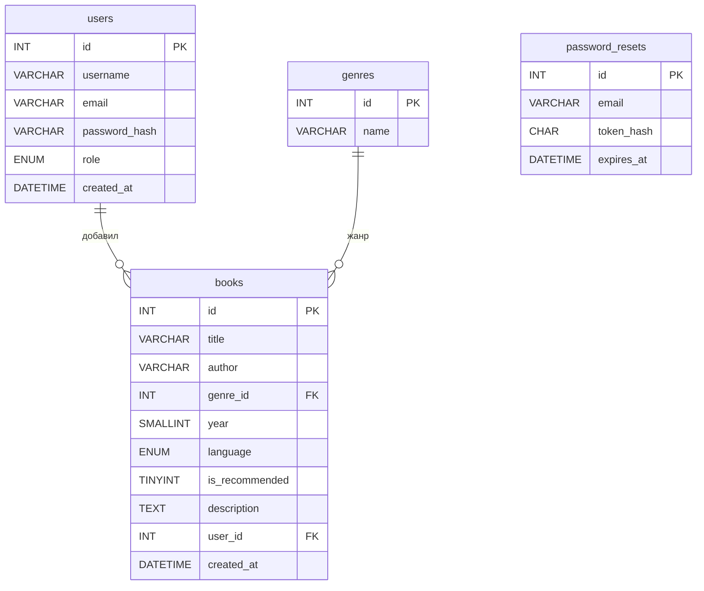

**users** — пользователи

| Поле | Тип | Описание |
|---|---|---|
| id | INT, PK | Идентификатор |
| username | VARCHAR(30), UNIQUE | Логин |
| email | VARCHAR(100), UNIQUE | Email (используется для входа) |
| password_hash | VARCHAR(255) | Хэш пароля |
| role | ENUM('user','admin') | Роль |
| created_at | DATETIME | Дата регистрации |

**genres** — жанры

| Поле | Тип | Описание |
|---|---|---|
| id | INT, PK | Идентификатор |
| name | VARCHAR(50), UNIQUE | Название жанра |

**books** — книги (основной ресурс)

| Поле | Тип | Описание |
|---|---|---|
| id | INT, PK | Идентификатор |
| title | VARCHAR(200) | Название |
| author | VARCHAR(100) | Автор |
| genre_id | INT, FK → genres.id | Жанр (`ON DELETE RESTRICT` — нельзя удалить жанр с книгами) |
| year | SMALLINT | Год издания |
| language | ENUM('ru','en','other') | Язык |
| is_recommended | TINYINT(1) | Отметка «рекомендую» |
| description | TEXT | Описание |
| user_id | INT, FK → users.id | Кто добавил (`ON DELETE SET NULL` — книга остаётся после удаления пользователя) |
| created_at | DATETIME | Дата добавления |

**password_resets** — токены восстановления пароля

| Поле | Тип | Описание |
|---|---|---|
| id | INT, PK | Идентификатор |
| email | VARCHAR(100) | Email пользователя |
| token_hash | CHAR(64) | SHA-256 хэш токена (сам токен в БД не хранится) |
| expires_at | DATETIME | Срок действия ссылки |

### 3.5. Архитектура приложения

Приложение построено по схеме **MVC** (Model-View-Controller):
- **Model** (`app/models`) — работа с таблицами базы данных;
- **View** (`app/views`) — HTML-шаблоны страниц;
- **Controller** (`app/controllers`) — принимает запрос, вызывает модели и выбирает шаблон.

```
├── config/
│   ├── config.php            настройки подключения к БД и адрес сайта
│   └── routes.php            таблица маршрутов: ?page=... → контроллер и метод
├── public/                   единственная папка, доступная из браузера
│   ├── index.php             точка входа (front controller)
│   ├── css/style.css
│   └── js/validation.js      проверка форм на клиенте
├── app/
│   ├── core/                 ядро приложения
│   │   ├── Database.php      подключение к MySQL через PDO
│   │   ├── Controller.php    базовый контроллер (вывод шаблонов, страница 404)
│   │   ├── Model.php         базовая модель (доступ к БД)
│   │   ├── Auth.php          вход, выход, проверка прав
│   │   ├── Validator.php     проверка данных форм
│   │   └── helpers.php       e(), url(), redirect(), CSRF, flash-сообщения, send_mail()
│   ├── models/               User, Book, Genre, PasswordReset
│   ├── controllers/          HomeController, BookController, AuthController, AdminController
│   └── views/                шаблоны: layout, home, books, auth, admin, errors
├── database/schema.sql       создание таблиц и тестовые данные
├── storage/                  сюда записываются «письма» (mail.log)
└── docs/screenshots/         скриншоты для отчёта
```

**Как обрабатывается запрос** (на примере `index.php?page=search&genre_id=2`):
1. `public/index.php` запускает сессию, подключает настройки и регистрирует автозагрузку классов.
2. В `config/routes.php` по ключу `search` находится пара `['BookController', 'search']`.
3. `BookController::search()` проверяет параметры фильтра и вызывает модель `Book::search()`.
4. Модель выполняет подготовленный SQL-запрос и возвращает массив книг.
5. Контроллер передаёт данные в шаблон `views/books/search.php`, который выводится между общей шапкой и подвалом.

### 3.6. Безопасность

| Угроза | Защита |
|---|---|
| SQL-инъекции | Все запросы выполняются через подготовленные выражения PDO (`prepare` + `execute`), данные передаются отдельно от SQL |
| XSS (внедрение скриптов) | Всё, что выводится на страницу, проходит через функцию `e()` (`htmlspecialchars`) |
| CSRF (подделка запросов) | В каждой POST-форме есть скрытый токен, он сверяется через `hash_equals()` |
| Кража паролей из БД | Хранится только хэш (`password_hash`, алгоритм bcrypt) |
| Фиксация сессии | После входа вызывается `session_regenerate_id(true)` |
| Кража cookie через JS | Cookie сессии с флагами `HttpOnly` и `SameSite=Lax` |
| Обход авторизации | Права проверяются на сервере (`Auth::requireLogin()`, `Auth::requireAdmin()`), роль берётся из БД при каждом запросе |
| Перебор email при входе и восстановлении | Одинаковые сообщения для существующих и несуществующих адресов |
| Повторное использование ссылки сброса | Токен одноразовый, действует 1 час, в БД хранится только его хэш |
| Случайное удаление по ссылке | Удаление и выход выполняются только POST-запросом, с подтверждением |

---

## 4. Примеры использования

### 4.1. Скриншоты

**Главная страница** — три динамических блока из базы данных:

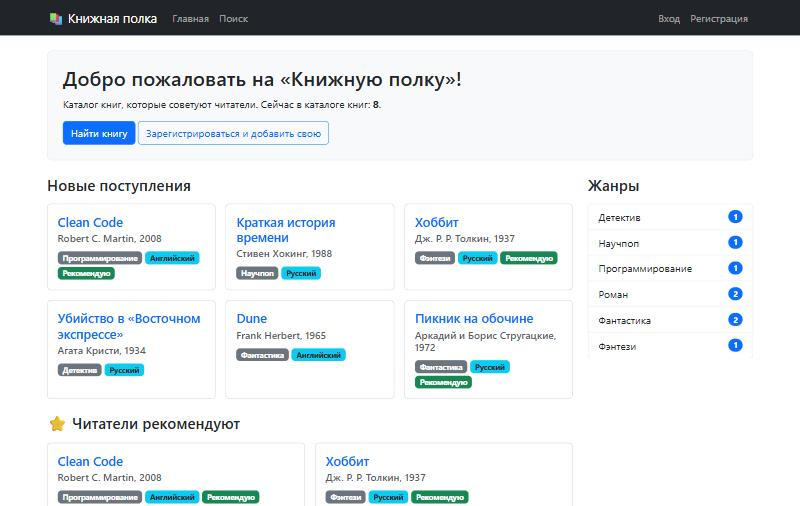

**Поиск книг** по нескольким критериям:

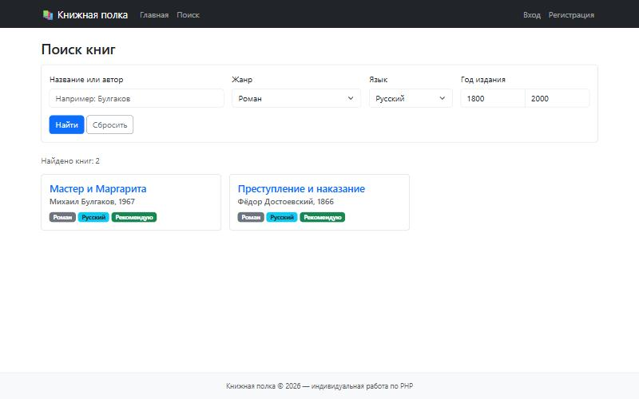

**Страница книги:**

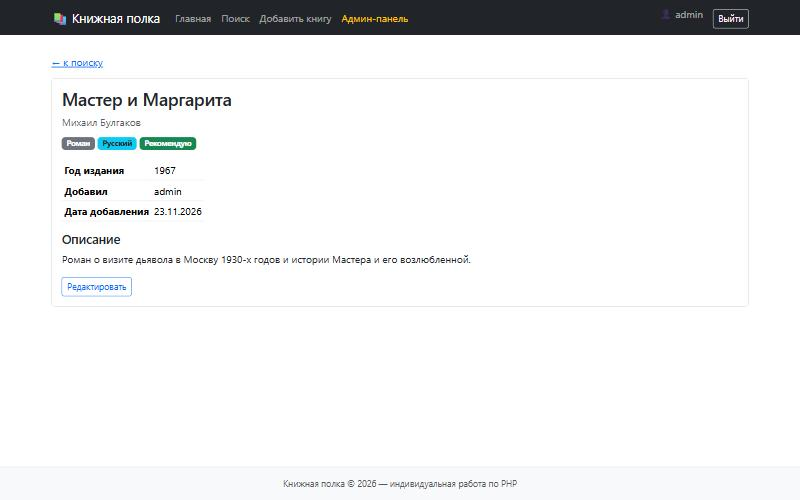

**Вход: ошибка при неверном пароле**

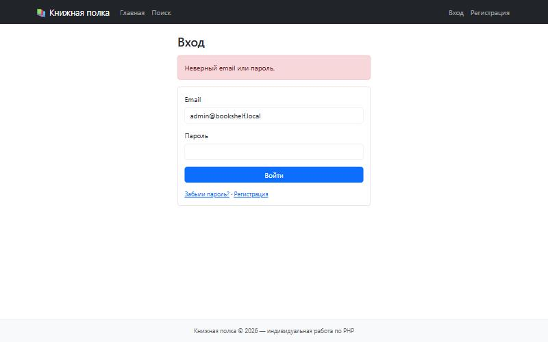

**Форма добавления книги: ошибки серверной проверки** выводятся под каждым полем,
введённые данные сохраняются:

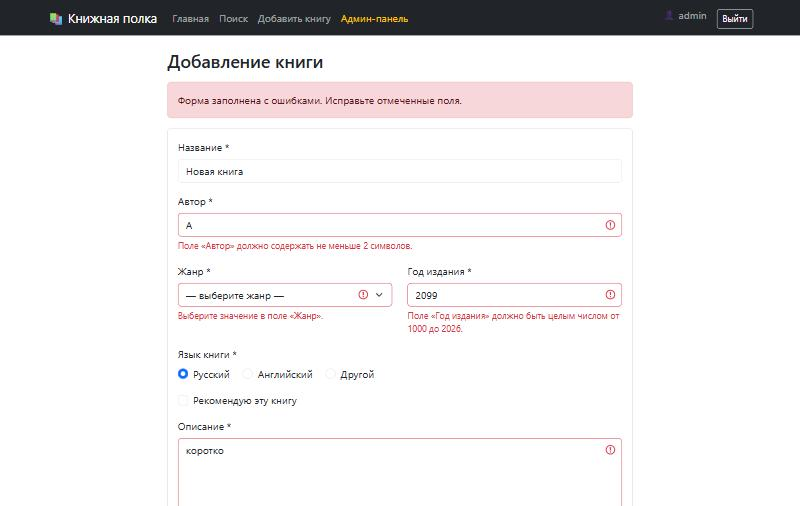

**Восстановление пароля:**

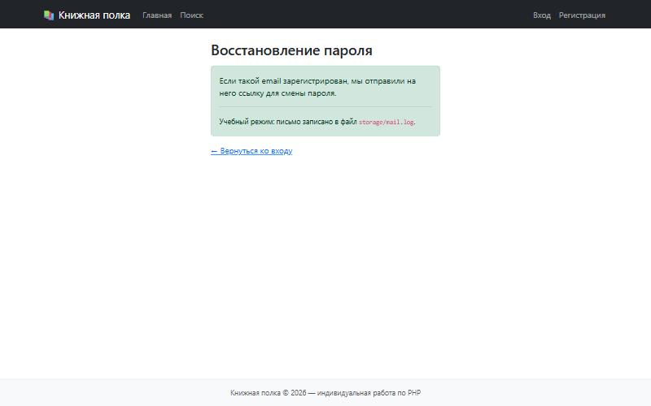

**Админ-панель:**

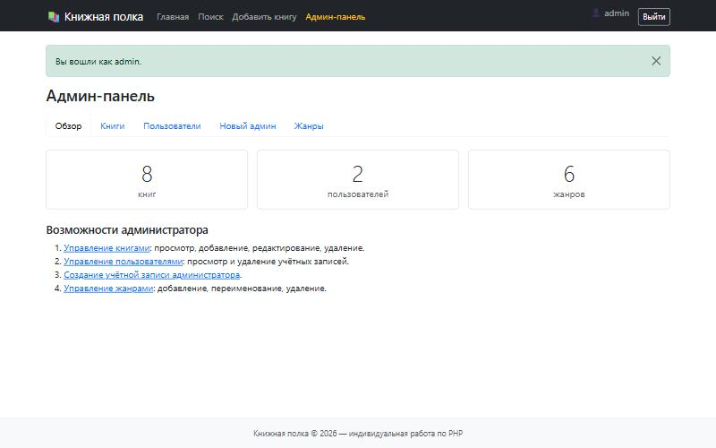

**Управление книгами:**

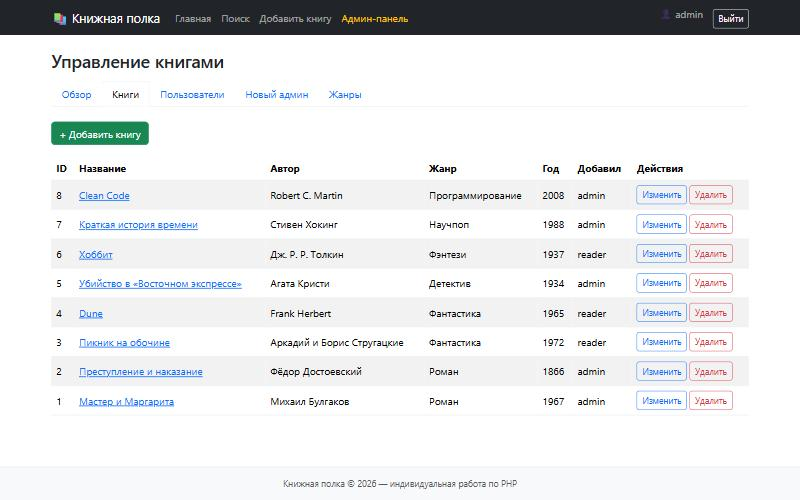

**Управление пользователями:**

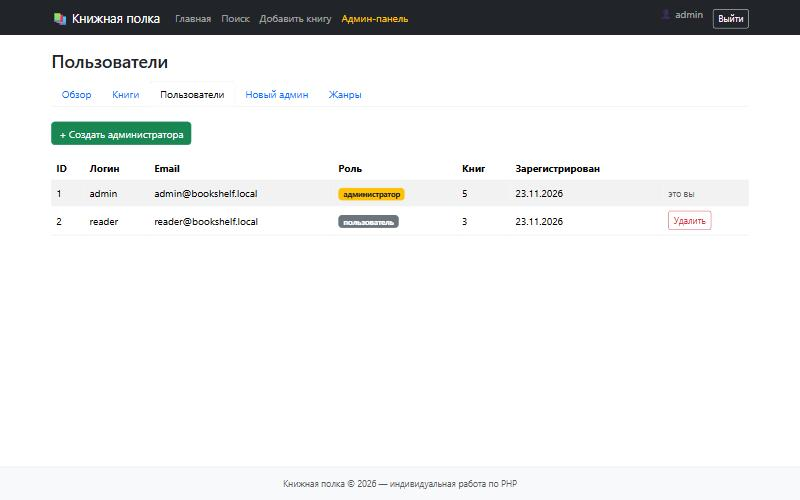

**Управление жанрами:**

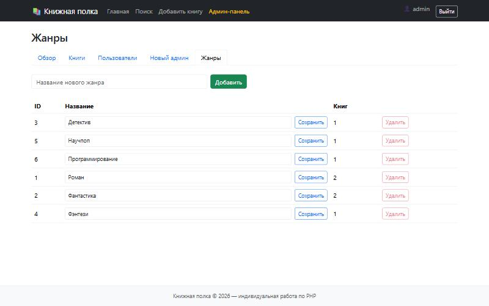

### 4.2. Фрагменты кода

**Регистрация: пароль сохраняется только в виде хэша** (`app/models/User.php`):

```php
public function create(string $username, string $email, string $password, string $role = 'user'): int
{
    $stmt = $this->db->prepare(
        'INSERT INTO users (username, email, password_hash, role) VALUES (?, ?, ?, ?)'
    );
    $stmt->execute([$username, $email, password_hash($password, PASSWORD_DEFAULT), $role]);
    return (int)$this->db->lastInsertId();
}
```

**Вход: проверка пароля и смена id сессии** (`app/controllers/AuthController.php`, `app/core/Auth.php`):

```php
$user = (new User())->findByEmail($email);

if ($user !== null && password_verify($password, $user['password_hash'])) {
    Auth::login($user);   // внутри: session_regenerate_id(true); $_SESSION['user_id'] = ...
    redirect($user['role'] === 'admin' ? 'admin' : 'home');
}
$error = 'Неверный email или пароль.';
```

**Защита админ-панели** — проверка выполняется в конструкторе, поэтому распространяется
на все методы контроллера (`app/controllers/AdminController.php`):

```php
public function __construct()
{
    Auth::requireAdmin();   // гость → на страницу входа, пользователь → ошибка 403
}
```

**Серверная проверка формы книги** (`app/models/Book.php`):

```php
$v = new Validator();
$v->required('title', $data['title'], 'Название')
  ->maxLength('title', $data['title'], 200, 'Название');
$v->inList('genre_id', $data['genre_id'], $genreIds, 'Жанр');
$v->required('year', $data['year'], 'Год издания')
  ->integerBetween('year', $data['year'], 1000, (int)date('Y'), 'Год издания');
$v->inList('language', $data['language'], array_keys(self::LANGUAGES), 'Язык');
```

**Поиск с подготовленным запросом** — SQL собирается только из заранее известных
условий, а значения пользователя передаются параметрами (`app/models/Book.php`):

```php
if ($filters['query'] !== '') {
    $where[] = '(b.title LIKE ? OR b.author LIKE ?)';
    $params[] = '%' . $filters['query'] . '%';
    $params[] = '%' . $filters['query'] . '%';
}
if ($filters['genre_id'] !== '') {
    $where[] = 'b.genre_id = ?';
    $params[] = (int)$filters['genre_id'];
}
// ...
$stmt = $this->db->prepare($sql);
$stmt->execute($params);
```

**CSRF-защита** (`app/core/helpers.php`):

```php
function verify_csrf(): void
{
    $token = $_POST['csrf_token'] ?? '';
    if (!hash_equals(csrf_token(), $token)) {
        http_response_code(419);
        exit('Ошибка безопасности: форма устарела. Обновите страницу и попробуйте снова.');
    }
}
```

**Проверка на клиенте** (`public/js/validation.js`) — форма с ошибками не отправляется:

```js
form.addEventListener('submit', function (event) {
    if (!form.checkValidity()) {
        event.preventDefault();
        event.stopPropagation();
    }
    form.classList.add('was-validated');
});
```

---

## 5. Ответы на контрольные вопросы

**1. Чем аутентификация отличается от авторизации?**  
Аутентификация — это проверка, что пользователь тот, за кого себя выдаёт (вход по email и паролю).
Авторизация — это проверка прав: что именно этому пользователю разрешено. В проекте
аутентификацию выполняет `AuthController::login()`, а авторизацию — `Auth::requireLogin()` и `Auth::requireAdmin()`.

**2. Почему пароли нельзя хранить в открытом виде? Как работает `password_hash()`?**  
Если базу данных украдут, злоумышленник сразу получит все пароли, а люди часто используют
одинаковые пароли на разных сайтах. `password_hash()` превращает пароль в необратимый хэш
(по умолчанию алгоритм bcrypt) и автоматически добавляет случайную «соль», поэтому
у одинаковых паролей получаются разные хэши. При входе `password_verify()` хэширует
введённый пароль с той же солью и сравнивает результат с хэшем из базы.

**3. Почему нельзя использовать для паролей MD5 или SHA-1?**  
Это быстрые хэш-функции: на видеокарте можно перебирать миллиарды вариантов в секунду.
Кроме того, для них есть готовые таблицы хэшей популярных паролей. Bcrypt специально
сделан медленным и использует соль.

**4. Что такое сессия в PHP и как она работает?**  
Сессия — это данные пользователя, которые хранятся на сервере между запросами. При вызове
`session_start()` PHP отправляет браузеру cookie с идентификатором сессии (`PHPSESSID`),
а данные хранит на сервере в массиве `$_SESSION`. В проекте в сессии хранятся id
вошедшего пользователя, CSRF-токен и одноразовые сообщения.

**5. Что такое фиксация сессии и как от неё защищаться?**  
Злоумышленник заранее подсовывает жертве известный ему идентификатор сессии и ждёт, пока
жертва войдёт в систему. Защита — выдавать новый идентификатор после входа:
`session_regenerate_id(true)`.

**6. Что такое SQL-инъекция? Как её предотвратить?**  
Это внедрение SQL-кода через данные пользователя. Например, ввод `' OR '1'='1` в поле
поиска может изменить смысл запроса. Защита — подготовленные запросы (prepared statements):
SQL-запрос с плейсхолдерами `?` отправляется отдельно от данных, поэтому данные никогда
не выполняются как код.

**7. Что такое XSS и как от неё защититься?**  
Cross-Site Scripting — внедрение JavaScript-кода на страницу. Например, книга с названием
`<script>...</script>` могла бы выполнить скрипт у всех посетителей. Защита — экранировать
вывод через `htmlspecialchars()`, который превращает `<` в `&lt;` и так далее. В проекте
для этого используется функция `e()`.

**8. Что такое CSRF-атака и как работает CSRF-токен?**  
Cross-Site Request Forgery — чужой сайт заставляет браузер вошедшего пользователя
отправить запрос на наш сайт (например, удалить книгу). Браузер сам приложит cookie
сессии, и запрос выполнится от имени пользователя. Защита — случайный токен, который
хранится в сессии и вставляется скрытым полем в каждую форму. Чужой сайт не знает токен,
поэтому его запрос будет отклонён.

**9. Зачем проверять данные и на клиенте, и на сервере?**  
Проверка на клиенте (HTML5, JavaScript) удобна пользователю: ошибки видны сразу, без
перезагрузки страницы. Но её легко обойти: отключить JavaScript, изменить HTML или
отправить запрос напрямую. Поэтому проверка на сервере обязательна — только ей можно доверять.

**10. В чём разница между методами GET и POST? Где какой используется в проекте?**  
GET передаёт параметры в адресной строке, такой запрос можно сохранить в закладки, и он
не должен ничего менять. POST передаёт данные в теле запроса и используется для действий,
которые меняют данные. В проекте поиск работает через GET (ссылку с фильтрами можно
отправить другому человеку), а регистрация, добавление, удаление и выход — через POST.

**11. Что такое архитектура MVC и какие у неё преимущества?**  
MVC делит приложение на три части: модель (данные и работа с БД), представление (HTML)
и контроллер (обработка запроса и связь модели с представлением). Код становится проще
читать и расширять: например, чтобы добавить новую страницу, достаточно добавить маршрут,
метод контроллера и шаблон, не трогая остальной код.

**12. Что такое PDO и чем он удобен?**  
PDO (PHP Data Objects) — встроенный в PHP интерфейс для работы с базами данных.
Он поддерживает подготовленные запросы, выбрасывает исключения при ошибках и работает
с разными СУБД (MySQL, SQLite, PostgreSQL) через одинаковые методы.

**13. Как реализовано восстановление пароля и почему оно безопасно?**  
Генерируется криптографически случайный токен (`random_bytes`), в базу записывается
только его SHA-256 хэш со сроком действия 1 час, а ссылка с токеном отправляется
на email. По ссылке можно один раз задать новый пароль, после чего токен удаляется.
Чтобы нельзя было узнать, зарегистрирован ли адрес, сообщение одинаковое для любого email.

**14. Что такое PHPDoc и зачем он нужен?**  
PHPDoc — стандарт комментариев к коду (`/** ... */`) с тегами `@param`, `@return`, `@var`.
Он описывает назначение функции, её параметры и результат. Среды разработки используют
PHPDoc для подсказок, а по нему можно автоматически сгенерировать документацию.

---

## 6. Список использованных источников

1. Документация PHP: https://www.php.net/manual/ru/
2. PHP: Хеширование паролей (`password_hash`, `password_verify`): https://www.php.net/manual/ru/book.password.php
3. PHP: PDO и подготовленные запросы: https://www.php.net/manual/ru/book.pdo.php
4. PHP: Сессии: https://www.php.net/manual/ru/book.session.php
5. PHP: `htmlspecialchars`: https://www.php.net/manual/ru/function.htmlspecialchars.php
6. Документация MySQL 8: https://dev.mysql.com/doc/refman/8.0/en/
7. OWASP Cheat Sheet Series: SQL Injection Prevention, XSS Prevention, CSRF Prevention, Password Storage, Session Management: https://cheatsheetseries.owasp.org/
8. MDN Web Docs: Проверка данных формы на стороне клиента: https://developer.mozilla.org/ru/docs/Learn/Forms/Form_validation
9. Документация Bootstrap 5: https://getbootstrap.com/docs/5.3/
10. PHPDoc Reference: https://docs.phpdoc.org/
11. PHP The Right Way: https://phptherightway.com/

---

## 7. Выводы

В ходе работы было разработано веб-приложение «Книжная полка» на PHP и MySQL. Реализованы:
регистрация и вход с безопасным хранением паролей, восстановление пароля через одноразовую
ссылку, общедоступный раздел с динамическими данными из базы, форма добавления книги
с проверкой на клиенте и на сервере, форма поиска по нескольким критериям и админ-панель
с четырьмя функциями управления данными.

Приложение защищено от основных веб-уязвимостей (SQL-инъекции, XSS, CSRF, фиксация сессии).
Код разделён по схеме MVC и задокументирован с помощью PHPDoc. В ходе работы я закрепил
навыки серверного программирования на PHP, работы с базой данных через PDO,
работы с сессиями и защиты веб-приложений.
